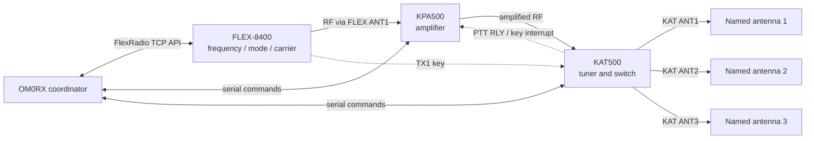
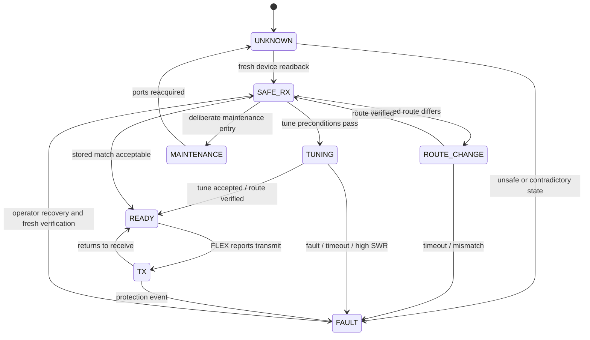
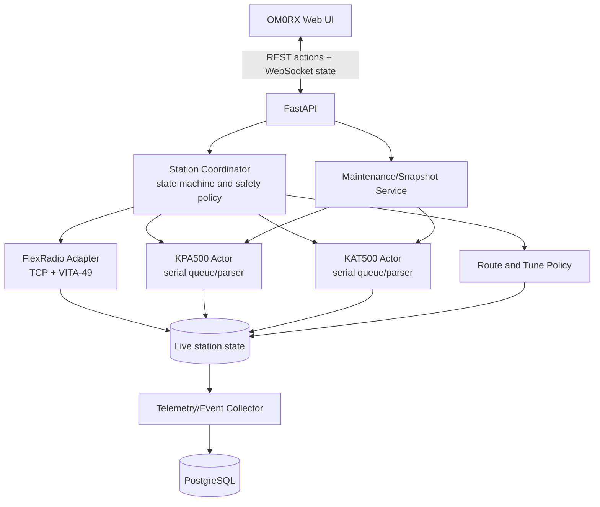

# OM0RX Unified FlexRadio–Elecraft Management Suite

**Document type:** Feasibility study, product definition, and implementation plan  
**Status:** Active implementation; commissioning locked  
**Prepared:** 4 October 2026  
**Repository:** `om0rx-radio-control`  
**Scope:** FLEX-8400, KPA500, and KAT500 management in one web interface  
**Implementation status:** Milestones 1–3, safety hardening, unified alarms, safe Maintenance Mode, guarded multi-point ATU training, measurement-only SWR surveys, persisted SWR profile history, configuration snapshot/restore preview, and commissioning-readiness evaluation implemented in the working tree on 4 October 2026

## Implementation progress

### 4 October 2026 — Milestone 1: trustworthy read-only station path

Implemented in the working tree:

- a normalized backend station-path contract with explicit alignment, mismatches, unknown reasons, per-stage freshness, missing-field evidence, and a permanent `transmit_authorized: false` marker;
- separate FLEX TX-port and KAT output stages so matching antenna numbers are never inferred;
- KPA/KAT responsiveness, observation timestamps, quality, and missing-field reporting;
- fail-closed handling of a silent/offline KPA500, without treating no response as confirmed power-off; an explicit transient `^ON0` remains compatibility evidence only;
- fail-stale FLEX observations based on actual received/query evidence rather than the background loop time;
- legacy direct Elecraft device writes gated off by default pending the safety coordinator;
- a responsive four-stage read-only dashboard with status, telemetry, mismatches, and named-output support;
- configurable KAT output names without inventing physical antenna types;
- expanded backend and frontend contract tests.

The running station backend was not restarted during development. The new backend contract and default safety gate therefore take effect at the next controlled restart. The current frontend retains a conservative compatibility fallback until then.

### 4 October 2026 — Milestones 2–3: guarded coordination, tune workflow, and history

Implemented in the working tree:

- exact KPA500/KAT500 transactional readback and strict target comparison;
- a single station coordinator and `/api/station` contract for route preparation, standby, operate, tune, cancellation, capabilities, and read-only path/state;
- a commissioning latch that defaults to locked and cannot be enabled through the ordinary web configuration API;
- fresh independent FLEX receive/interlock proof before station changes;
- digital-engine ownership and pending-TX interlocks;
- serialized route changes: KPA standby, FLEX TX-port policy, KPA/KAT band, KAT frequency/output, then exact readback;
- non-storing KAT full tune at clamped low FLEX power, mandatory carrier-off handling, SWR acceptance thresholds, and memory store only after a successful result;
- cancellation/timeout/failure cleanup that removes the carrier and leaves the KPA500 in standby;
- PostgreSQL-backed snapshots, scalar telemetry, permanent events and tune outcomes, retention, and bounded read-only history APIs;
- commissioning-guarded workflow controls plus a dependency-free telemetry/history panel;
- configuration locking and route-verification invalidation during station-related changes.

Safety hardening completed after the initial milestone implementation:

- startup recovery commands both FLEX TUNE and MOX off, independently proves receive, and confirms KPA standby before station controls unlock;
- all OM0RX frequency/band changes de-escalate the KPA to confirmed standby and invalidate the prior route before QSY;
- raw TUNE-on and direct Elecraft lifecycle/mutation endpoints are retired; emergency TUNE/MOX off remains available;
- restart/shutdown refuses to claim a safe exit when FLEX receive or KPA standby cannot be proven;
- route-affecting configuration changes require fresh receive and confirmed amplifier standby;
- an explicit amplifier band allow-list excludes 60 m by default and fails closed for unlisted bands;
- tune completion rechecks live RF, FLEX route, KAT route/fault state, and carrier-off state before storing memory.

Safe Maintenance Mode backend completed after safety hardening:

- coordinator-only enter/exit endpoints preserve the action-then-radio lock order;
- entry requires fresh FLEX receive, commands TUNE and MOX off, confirms KPA500 standby, invalidates route proof, stops polling, and closes both serial ports;
- maintenance is explicit in read-only state while prepare, operate, tune, raw TX, and QSY paths fail closed;
- exit reopens and re-identifies configured devices, refreshes exact state, and keeps FLEX in receive and KPA500 in standby before controls and polling resume;
- failed exit verification closes the ports again and retains maintenance plus recovery locks;
- firmware, factory reset, bulk erase, and raw serial lifecycle APIs remain deliberately unsupported;
- the documented KAT500 per-band/per-antenna frequency-memory clear primitive is implemented only at the device adapter layer with strict scope validation. It has no web or coordinator execution endpoint before commissioning.

GET-only hardware validation succeeded at 38,400 baud on the dedicated test endpoints while the Remote applications were disconnected: KPA500 COM17, firmware 1.54, standby/no fault; KAT500 COM15, firmware 2.16, AUTO/ANT2/40 m/no fault. No relay, antenna, operate, tune, memory, firmware, reset, or erase command was sent. The local settings are staged to use COM17/COM15 on the next controlled restart.

**Next milestone:** continue the [controlled commissioning runbook](ELECRAFT_COMMISSIONING_RUNBOOK.md) across every approved route and band. The first supervised three-point 40 m training run completed successfully; SWR-only survey mode and multi-band operation still require operator-observed hardware acceptance before routine use.

### 4 October 2026 — Phase 4 ATU Auto Setup and supervised execution

The dedicated Station Management window now includes a professional
**ATU Auto Setup** workspace. The operator can select one or several bands, choose
CW/Data/SSB portions, compare representative sampling with every overlapping
KAT500 memory bin, and preview a selective clear for only the routed KAT antenna.
The planner uses the documented 10/20/100/200 kHz KAT bin sizes, de-duplicates
points that share a memory bin, caps every request at 100 points, and calculates
the exact FLEX port, KAT output/name, amplifier policy, clamped tune power, and
worst-case duration. Invalid frequencies and missing routes fail closed;
amplifier-prohibited bands such as 60 m remain visibly blocked.

The browser includes a dependency-free SWR profile chart with before/after
series and target/abort lines. Guarded, single-owner jobs now execute one point
at a time through the station coordinator, with bounded retry, detailed event
diagnostics, cancellation, and mandatory carrier-off/KPA-standby cleanup. The
operator still builds and inspects a calculation-only plan first, completes the
station safety attestations, and accepts a final Yes/No RF dialog before a job is
created. A supervised three-point 40 m run completed successfully on the live
station.

Two RF job types share the same plan and safety envelope:

- **Training** performs the verified KAT tune and stores memory only after an
  accepted result.
- **SWR survey** temporarily switches KAT500 from AUTO to MAN, recalls the
  existing frequency memory, measures at low power without tuning or storing,
  and restores the original KAT mode when the job releases the station.

Tune and survey results are persisted and grouped into selectable historical SWR
profiles. After a successful survey, the operator can choose an SWR threshold
(1.50 by default) and build a new explicit-frequency plan containing only the
points above that threshold. “Select all bands” and “Clear bands” shortcuts make
single-band and all-band sweeps equally direct. Memory erase remains a separate,
more destructive training option and is prohibited in survey mode.

### 4 October 2026 — Phase 5 management foundation

The working tree now exposes a unified, read-only alarm contract derived from
cached station state. Faults, path mismatches, stale observations, failed tunes,
maintenance, recovery, and commissioning are normalized into stable codes and
severity levels for the web dashboard. Optional amplifier temperature and
voltage alarms remain disabled unless explicit station-specific thresholds are
configured.

Semantic configuration snapshots can also be exported through the station API.
They include supported connection, route, tune-safety, and telemetry settings
plus cached device identity, while deliberately excluding secrets,
commissioning, firmware images, live operate state, and raw EEPROM content. A
restore-preview endpoint validates a supplied snapshot and classifies every
change, including whether Maintenance Mode would be required. There is no
restore/apply endpoint before controlled hardware acceptance. The browser now
provides snapshot download and saved-file preview controls with the same
preview-only restriction displayed beside them.

### 4 October 2026 — Controlled-rollout preparation

A cached-state-only commissioning evaluator and browser checklist now separate
receive-only readiness from supervised low-power readiness. Automated checks
cover the commissioning lock, coordinator recovery/maintenance state, FLEX
receive evidence, KPA standby/fault state, KAT idle/fault state, route policy,
band eligibility, tune-power ceiling, follow-radio configuration, and retired
legacy writes. Five human attestations remain explicit: physical key interrupt,
antenna routes and names, vendor backups, approved load/antenna, and digital
engine inhibit. The evaluation is not persisted, never queries hardware, cannot
enable commissioning, and permanently excludes 60 m from low-power testing.

The accompanying runbook defines the receive-only observation, maintenance
handoff, supervised low-power cases, stop conditions, evidence capture, and
rollback. The independent commissioning latch remains outside the web API.

## Executive decision

Build the unified suite as a station-level subsystem inside OM0RX Radio Control.

It is technically feasible to replace the two Elecraft Remote applications and almost all day-to-day functions of the KPA Utility and KAT500 Utility with one browser-based interface. The existing repository already has the correct foundations: a FastAPI backend, a browser UI, a FlexRadio TCP client, basic KPA500/KAT500 serial drivers, REST endpoints, and PostgreSQL.

The suite should not be designed as four Windows programs reproduced inside a browser. It should manage the complete RF path as one coordinated system:

> FLEX-8400 transmit port → KPA500 amplifier → KAT500 tuner/antenna switch → named physical antenna

Published Elecraft protocols are sufficient for normal monitoring, operation, route selection, safe tuning, most configuration, fault handling, and KAT500 memory management. They are not sufficient to promise literal 100% replacement of the vendor utilities. In particular, Elecraft does not publish a supported firmware-transfer protocol, and some bulk EEPROM backup/restore and historical-fault functions are not fully documented. The practical target is therefore:

- one always-running OM0RX web suite for all routine station use;
- no KPA500 Remote or KAT500 Remote windows;
- no vendor utility running during normal operation;
- a controlled Maintenance Mode that releases the serial ports for the official utilities only for firmware, recovery, or any still-undocumented maintenance operation;
- optional full maintenance parity later, only if Elecraft supplies and authorizes the missing protocols.

This achieves the real operational goal—one coherent station console—instead of risking equipment to chase an unsupported definition of “100%”.

## 1. Product vision

The operator should see one station, not three devices and four programs. The primary screen should answer these questions at a glance:

- What frequency, band, and mode is the FLEX using?
- What complete RF route is selected?
- Which physical antenna is actually connected?
- Are the FLEX, amplifier, tuner, key line, and interlocks ready to transmit?
- What are forward power, reflected power, SWR, voltage, current, and temperature?
- Is a tune required, recommended, in progress, complete, or unsafe?
- If something is wrong, what failed, what was automatically made safe, and what should the operator do?

The target experience is a single web dashboard usable locally or remotely, with a simple normal operating view and deeper configuration and maintenance views when required.

## 2. Goals and non-goals

### 2.1 Goals

1. Consolidate FLEX-8400, KPA500, and KAT500 status and controls in OM0RX.
2. Replace both Elecraft Remote applications for normal use.
3. Replace routine KPA Utility and KAT500 Utility configuration functions where the public protocols support them.
4. Treat antenna selection as an end-to-end route, not as unrelated device settings.
5. Prevent relay switching, tuning, or amplifier operation in an unsafe state.
6. Provide one-click, transactional low-power tuning controlled through the FLEX and KAT500.
7. Learn and maintain good matches across selected operating segments without blindly sweeping entire bands.
8. Record telemetry, tunes, route changes, warnings, and faults for charts and diagnosis.
9. Preserve a safe escape hatch to the official Elecraft utilities.
10. Fit naturally into the current OM0RX backend, frontend, database, and deployment model.

### 2.2 Non-goals for the first release

- Reimplementing SmartSDR or replacing the FLEX panadapter/audio client.
- Flashing Elecraft firmware through reverse-engineered or undocumented commands.
- Automatically transmitting across entire amateur bands without operator-approved limits.
- Treating a browser as the only protection against RF or keying faults.
- Supporting arbitrary amplifier/tuner brands before the Elecraft workflow is proven.
- Changing the physical station wiring without first documenting and validating it.

## 3. Current station baseline

### 3.1 Observed hardware and software state

The following was observed from the running OM0RX system on 4 October 2026:

| Component | Observed state |
|---|---|
| FLEX radio | 7.074 MHz, DIGU, 40 m |
| FLEX antenna policy | FLEX ANT1 on all configured HF bands |
| KPA500 | Connected on COM16 at 38,400 baud; firmware 1.54; powered; standby; 31 °C; 69 V; no current fault |
| KAT500 | Connected on COM14 at 38,400 baud; firmware 2.16; AUTO; KAT antenna 2; SWR 1.28 |
| Follow-radio behavior | Enabled |
| Current KAT antenna policy | KAT ANT2 on 160/80/60/40/30 m; KAT ANT1 on 20/17/15/12/10/6 m |
| KPA500 Remote | Installed and running, version 1.0.17.0 |
| KAT500 Remote | Installed and running, version 1.0.16.0 |
| KPA Utility | Installed, version 1.13.7.16 |
| KAT500 Utility | Installed, version 1.25.2.12 |

The existing integration notes identify physical ports COM6 for the KPA500 and COM11 for the KAT500, with VSPE exposing shared virtual ports to OM0RX and the Remote applications. Those physical assignments must be verified during discovery rather than assumed.

### 3.2 Existing OM0RX foundation

The repository already contains:

- a FastAPI backend and browser-based frontend;
- PostgreSQL persistence;
- an established FlexRadio TCP connection and station state model;
- FLEX frequency, mode, receive/transmit antenna, RF power, tune power, MOX, and interlock awareness;
- basic KPA500/KAT500 serial connections and polling;
- basic Elecraft REST actions for connection, power, operate/standby, KAT mode, antenna, and tune;
- automatic KPA band and KAT frequency/band/antenna following from the FLEX;
- a basic Elecraft configuration panel.

This means the work is an extension and hardening of a functioning integration, not a greenfield device-control project.

### 3.3 Current usability problem

The present desktop arrangement separates related information into multiple small windows. The supplied screenshot shows KPA status in one window and KAT status in another, while the management utilities add two more applications for configuration and firmware. There is no single representation of the complete transmit path, no shared alarm model, and no transactional coordination between FLEX carrier generation, amplifier state, tuner relays, and antenna selection.

## 4. Correct station topology

### 4.1 The important antenna distinction

FLEX ANT1 and KAT ANT1 are not the same switch position.

- **FLEX ANT1** is the radio's RF connector feeding the amplifier/tuner chain.
- **KAT ANT1, ANT2, and ANT3** are downstream antenna outputs after the amplifier and tuner.

For the present 40 m example, the route is expected to be:

> FLEX ANT1 → KPA500 → KAT500 → KAT ANT2 → 40 m antenna

The fact that the KAT uses its output 2 does not mean the FLEX should switch to its ANT2 connector. Doing so could bypass the intended chain or select an unrelated physical path. The new product must therefore display and apply named **route profiles**, not mirror antenna numbers between devices.

### 4.2 Logical topology

The as-built RF and keying paths must be traced and photographed in Phase 0. The recommended Elecraft/Flex arrangement places the KAT500 key-interrupt relay in series so the tuner can prevent amplifier keying while its relays move.

### 4.3 One frequency authority

Only one subsystem should be authoritative for frequency. For this station, the recommended authority is the FLEX state received through its TCP API and coordinated by OM0RX. Direct USB CAT feeds or RF-sense frequency acquisition may remain available as explicitly configured fallbacks, but they must not compete with the normal OM0RX control path.

## 5. Feasibility assessment

### 5.1 Overall verdict

| Area | Verdict | Confidence | Notes |
|---|---|---:|---|
| Unified browser monitoring | Feasible | High | All required routine readings are documented or already present in OM0RX |
| Remote operating controls | Feasible | High | Public KPA/KAT serial commands cover routine operation |
| FLEX coordination | Feasible | High | FlexRadio publishes TCP and VITA-49 APIs; OM0RX already uses the TCP API |
| Safe route orchestration | Feasible | High | Requires a new coordinator and verified physical interlocks |
| Safe automated KAT tuning | Feasible | High | FLEX tune carrier plus KAT tune/status/memory commands are available |
| Historical telemetry and charts | Feasible | High | PostgreSQL and web UI already exist |
| KAT configuration parity | Largely feasible | High | Broad public KAT command set includes band/antenna/memory settings |
| KPA configuration parity | Mostly feasible | Medium | Public commands cover important operating configuration; some utility-only functions need validation |
| Exact utility backup-file compatibility | Conditional | Medium/low | Bulk EEPROM/file formats are not fully documented |
| Firmware download parity | Not supportable from public documentation | High | Vendor utility should remain the supported method |

### 5.2 Meaning of “100% functionality”

The project should use three explicit levels:

1. **Operational parity:** everything needed during an operating session is available in OM0RX. This is achievable.
2. **Configuration parity:** normal device settings, route policies, tune memories, diagnostics, and backups are available in OM0RX. This is largely achievable, with a verification list for utility-only functions.
3. **Maintenance parity:** firmware flashing, bootloader recovery, and byte-for-byte vendor backup compatibility. This is conditional on Elecraft documentation or cooperation and is not a launch requirement.

## 6. Feature-parity inventory

### 6.1 KPA500 Remote replacement

| Existing function | Unified-suite treatment | Delivery |
|---|---|---|
| Power on/off | KPA card and station-wide safe power workflow | Release 1 |
| Operate/standby | Prominent state control governed by safety coordinator | Release 1 |
| Band display/select | Normally follows FLEX; manual maintenance override with warning | Release 1 |
| Output power | Live meter, numeric value, history chart | Release 1 |
| SWR | Live value with source, age, validity, and alarm thresholds | Release 1 |
| Current/PTT | Live status and chart; explicit transmit-state correlation | Release 1 |
| PA voltage | Live status and history | Release 1 |
| PA temperature | Live status, trend, and warning thresholds | Release 1 |
| Fan speed/minimum | Status plus configuration where supported | Release 2 |
| Current fault / clear | Unified alarm banner, explanation, audit, deliberate clear | Release 1 |
| Speaker alarm | Configuration where publicly supported; otherwise documented maintenance item | Release 2 |
| Mini/micro view | Responsive compact station widget | Release 1 |
| Remote host/client | Replaced by authenticated OM0RX web access rather than a raw serial TCP bridge | Release 1 |

### 6.2 KAT500 Remote replacement

| Existing function | Unified-suite treatment | Delivery |
|---|---|---|
| Power | KAT card and safe station workflow | Release 1 |
| AUTO/MAN/BYP mode | Clear mode control with route-policy guardrails | Release 1 |
| Antenna 1/2/3 | Named route selection; raw number shown secondarily | Release 1 |
| Full tune/cancel | Transactional Tune workflow with global cancel and timeout | Release 1 |
| SWR and bypass SWR | Live values, age/source, pre/post tune comparison, charts | Release 1 |
| Approximate frequency/band | Compared with FLEX authority; mismatch alarm | Release 1 |
| Forward/reflected voltage | Diagnostics and charts | Release 1 |
| Bypass/attenuator | Status and guarded control | Release 1 |
| Amplifier key interrupt | Status, configuration, and safety prerequisite | Release 1 |
| Fault / clear | Unified alarm banner and deliberate clear | Release 1 |
| Mini/micro view | Responsive compact station widget | Release 1 |
| Remote host/client | Replaced by secured OM0RX web access | Release 1 |

### 6.3 KPA Utility replacement

| Utility function | Unified-suite treatment | Feasibility |
|---|---|---|
| COM/baud selection, refresh, test | Device setup wizard and communications diagnostics | High |
| Operating telemetry and controls | Main station dashboard | High |
| Per-band ALC/power adjustment | Admin configuration with validation and readback | High |
| Standby-on-band-change and inhibit settings | Admin configuration and route workflow | High |
| Fan minimum, serial number, firmware/version | Maintenance page | High |
| Save/restore configuration | OM0RX JSON snapshot of publicly readable settings | High for settings; vendor-file compatibility unverified |
| Recent hard-fault table/export | Event log immediately in OM0RX; bulk device history requires protocol validation | Medium |
| Power-on banner | Nice-to-have; verify public command/support | Medium/low |
| Command tester/macros | Admin-only diagnostic console with a safe allow-list | High |
| Firmware check/download/install | Launch/use official utility in Maintenance Mode | Unsupported for native replacement without Elecraft protocol |

### 6.4 KAT500 Utility replacement

| Utility function | Unified-suite treatment | Feasibility |
|---|---|---|
| COM/baud selection and test | Device setup wizard | High |
| Mode, antenna, C/L, side, attenuator, bypass | Advanced tuner page with TX guards | High |
| Full tune/cancel/memorize | Safe tune transaction using non-store tune followed by explicit store | High |
| Frequency, VFWD, VRFL, SWR, bypass SWR | Live diagnostics and history | High |
| Band antenna enable/preference | Route-profile editor | High |
| SWR thresholds by band | Policy editor with safe defaults and readback | High |
| Amp-key interrupt threshold | Safety configuration; validate 1,500 W recommendation for KPA500 installation | High |
| Sleep/initial power/auto fine tune | Admin settings | High |
| Current frequency-bin data | Tune-memory inspector | High |
| Selective erase by band/antenna | Maintenance workflow with preview, typed confirmation, and backup | High |
| Factory reset | Maintenance-only, explicit confirmation, backup prerequisite | High technically; high operational risk |
| Save/restore configuration and memories | OM0RX semantic snapshots; exact vendor file compatibility requires validation | Medium/high |
| Device fault table | OM0RX event log plus device table if the public command is sufficient | Medium/high |
| Command tester/macros | Admin-only safe diagnostic console | High |
| Firmware check/download/install | Official utility in Maintenance Mode | Unsupported for native replacement without Elecraft protocol |

## 7. Target user experience

### 7.1 Main station dashboard

The Elecraft controls should leave the configuration modal and become a first-class station panel.

The top of the panel is a **station path strip**:

> `7.074 MHz · 40 m · DIGU` → `FLEX ANT1` → `KPA500 STANDBY` → `KAT500 AUTO` → `KAT ANT2` → `40 m antenna`

Every stage has a clear state:

- green: confirmed ready;
- amber: usable but attention or tune recommended;
- red: fault or transmit prohibited;
- grey: unknown/stale/disconnected—not treated as safe.

Below the path are three coordinated cards:

- **FLEX:** frequency, mode, TX slice, RX/TX antenna, MOX/TUNE, interlock, RF/tune power, forward/reflected power, SWR, PA temperature;
- **KPA500:** power, operate/standby, band, output, SWR, PA voltage/current/temperature, fan, fault;
- **KAT500:** power, mode, selected named antenna, SWR/bypass SWR, tune memory/bin, L/C/side, attenuator, key interrupt, fault.

Common actions sit next to the path rather than inside individual device cards:

- Prepare route;
- Tune;
- Cancel tune / stop carrier;
- Amplifier operate/standby;
- Select approved route;
- Acknowledge or inspect alarm.

### 7.2 Alarm and explanation model

The UI must explain a blocked action. For example:

> **Transmit inhibited:** KAT500 reports 20 m while the FLEX TX slice is on 40 m. KPA500 was placed in standby. Reapply the 40 m route or inspect tuner communications.

This is more useful than exposing only a raw fault code.

### 7.3 Deeper pages

- **Routes:** named antenna profiles, allowed bands/frequencies/modes, power limits, tune rules.
- **Tuning:** current bin, before/after SWR, tune progress, stored memories, band-training jobs.
- **History:** synchronized charts and event overlays.
- **Devices:** connection, firmware, commands, settings, calibration, and snapshots.
- **Maintenance:** release ports, official utility handoff, restore, erase, reset, and diagnostic console.

### 7.4 Roles

| Role | Capabilities |
|---|---|
| Monitor | View live state, charts, events, and configuration |
| Operator | Monitor plus approved route selection, tune, operate/standby, and safe fault acknowledgement |
| Administrator/Maintainer | Device configuration, snapshots, memory erase, maintenance mode, diagnostic commands |

## 8. Route profiles and policy model

### 8.1 Route profile structure

Each route is a complete, named path containing at least:

- profile name and operator-facing antenna name;
- permitted frequency ranges, bands, and modes;
- FLEX receive and transmit ports;
- whether the KPA500 is in the path and whether operate is allowed;
- KAT500 output 1/2/3 and preferred/enabled state;
- maximum FLEX drive and maximum intended station power;
- tune-power range and target SWR;
- warning and hard-stop SWR thresholds;
- whether an existing KAT memory is sufficient;
- whether automatic tune may be suggested or performed;
- any time-of-day, digital-mode, or contest restrictions.

Example profiles:

| Profile | FLEX TX port | KPA | KAT output | Intended use |
|---|---|---|---|---|
| `amplified-kat1` | ANT1 | In path | ANT1 | Named high-band antenna |
| `amplified-kat2` | ANT1 | In path | ANT2 | Named low-band antenna |
| `amplified-kat3` | ANT1 | In path | ANT3 | Spare/future antenna |
| `direct-flex-ant2` | ANT2 | Standby/out of path | Not applicable | Optional direct/bypass antenna, only if physically wired |

These are examples, not assumed wiring. Phase 0 replaces them with the verified station topology and real antenna names.

### 8.2 Policy resolution

When frequency changes, OM0RX should:

1. resolve all profiles valid for the TX frequency and mode;
2. choose the configured default or retain an operator-selected valid route;
3. calculate the exact desired state of each device;
4. compare desired state with fresh readback;
5. apply changes through the safety transaction;
6. expose conflicts instead of silently guessing.

## 9. Safety architecture

### 9.1 Safety is layered

The control software is an orchestration layer, not the only protection. The target station should use:

1. the verified physical key line, preferably FLEX TX1 → KAT500 PTT RLY → KPA500 KEY IN;
2. the KAT500 amplifier-key-interrupt feature;
3. FLEX hardware TX REQ or its documented software interlock where practical;
4. the OM0RX safety coordinator;
5. equipment-native protection and faults.

The FLEX internal ATU, if fitted and if the external KAT500 route is selected, must be confirmed bypassed.

### 9.2 Station state machine

The coordinator owns a single station state:

### 9.3 Non-negotiable invariants

1. Never switch a FLEX antenna, KAT antenna, KAT relay, or amplifier band while transmit is active or transmit state is unknown.
2. Never place the KPA500 in operate until the complete route is fresh, consistent, and read back.
3. Every safety-relevant write is followed by a query/readback; a successful serial write is not proof of device state.
4. Stale data is unknown, never green.
5. A communications loss during a transaction stops the FLEX tune carrier, keeps or requests KPA standby, and leaves transmit inhibited where possible.
6. All commands for a device are serialized through one owner; UI requests cannot interleave raw serial strings.
7. A tune has a hard timeout and a global cancel that first removes the FLEX carrier.
8. A route mismatch, band mismatch, unresolved fault, or invalid frequency blocks amplifier operate.
9. Destructive maintenance commands are unavailable in normal operating mode.
10. Automatic action must be visible and recorded with reason, inputs, result, and operator/system identity.

### 9.4 Safe route-change transaction

1. Detect and debounce the authoritative FLEX TX frequency/band.
2. Confirm FLEX is in receive, interlock is ready, and the state is stable.
3. Resolve the approved route and snapshot the current station state.
4. Put the KPA500 in standby if any RF-path relay or band will change.
5. Assert available inhibit/key-interrupt protection.
6. Apply the FLEX port, KPA band, KAT band/frequency, and KAT antenna in a tested safe order.
7. Query all affected values and compare them with the requested route.
8. Release inhibit and restore KPA operate only when the profile permits and every check passes.
9. On failure, remain in standby/inhibited, record the failure, and show one actionable alarm.

### 9.5 Safe tuning transaction

The unified Tune action should orchestrate all three devices:

1. Confirm that no QSO/transmission is active, no scheduled digital transmission is imminent, the route is valid, telemetry is fresh, and neither Elecraft device reports a fault.
2. Snapshot FLEX power/ATU/transmit state, KPA state, KAT mode/antenna, and the current tune-memory data.
3. Confirm/bypass the FLEX internal ATU for the external-tuner route.
4. Place the KPA500 in standby.
5. Select and verify the correct KAT route and frequency.
6. Initiate a KAT tune that does not yet store the result.
7. Set the FLEX tune power to an installation-tested value in the documented range; approximately 20 W is a sensible commissioning start, not a universal hard-coded value.
8. Turn the FLEX tune carrier on and poll KAT tuning status, SWR/bypass SWR, forward/reflected readings, and faults.
9. Remove the FLEX carrier immediately when tuning completes, is cancelled, times out, or faults.
10. Accept the result only if it meets the profile threshold and readings were valid under sufficient forward power.
11. Store the KAT memory explicitly only after acceptance.
12. Restore FLEX and KAT settings; restore KPA operate only after a final route/readiness verification.

### 9.6 Retune modes

Automatic retuning should be graduated rather than simply on/off:

- **Monitor:** report poor or stale match; never transmit automatically.
- **Recommend:** offer a Tune action when the station becomes idle.
- **Guarded automatic:** tune only between transmissions, inside an approved operating segment, with the digital/contest engine explicitly idle and all safety preconditions true.

For FT8 or other timed digital modes, “not currently keyed” is insufficient. The coordinator must know that it owns an idle interval and has enough time to finish or abort before the next slot.

### 9.7 Valid SWR handling

SWR must be qualified by source, time, and forward power. With no RF, the KPA can report no meaningful SWR, and a KAT value can be the last observed measurement. The UI and rules must distinguish:

- live measurement under sufficient forward power;
- recent last-observed measurement;
- stale measurement;
- no valid RF measurement.

Automatic decisions should use a sustained threshold with hysteresis, not a single sample.

## 10. Band training and tune-memory management

### 10.1 Purpose

The training workflow creates verified KAT memories for the frequencies the station actually uses. It is not an unattended “transmit everywhere” sweep.

### 10.2 Bin awareness

The KAT500 uses frequency bins that vary by range:

| Frequency range | Nominal bin width |
|---|---:|
| Below 3 MHz | 10 kHz |
| 3–26 MHz | 20 kHz |
| 26–38 MHz | 100 kHz |
| 38–60 MHz | 200 kHz |

Training jobs should align points to these bins, deduplicate already-good memories, and prefer user-defined operating segments such as FT8, SSB, CW, or contest ranges. Regulatory rules and the station's antenna limits must be represented as explicit allow-lists, especially on channelized bands such as 60 m.

### 10.3 Training workflow

1. Operator selects route, band segments, spacing, target SWR, maximum tune power, and store policy.
2. The system previews every proposed frequency and estimates time and relay operations.
3. Operator approves the job.
4. For each point, the system runs the safe tuning transaction without storing first.
5. It records bypass SWR, tuned SWR, tune duration, route, antenna, L/C/side, forward power, result, and reason.
6. It stores only acceptable results and skips known-good bins according to policy.
7. It enforces dwell, cooling, maximum consecutive failures, maximum duration, and a stop button.
8. It is resumable after cancellation or restart.

Start with a small set of actual operating frequencies and expand opportunistically. A full multi-band, multi-antenna grid can require hundreds of relay operations and is neither necessary nor kind to mechanical hardware.

## 11. Telemetry, charts, and events

### 11.1 Data sources

| Source | Suggested data |
|---|---|
| FLEX TCP state | frequency, mode, TX slice, RX/TX antenna, MOX/TUNE, interlock, RF power, tune power |
| FLEX VITA-49 meters | forward power, reflected power, SWR, PA temperature, and other selected meters |
| KPA500 | operate, band, output power, SWR, voltage, current, temperature, fan/config, fault |
| KAT500 | mode, antenna, band/frequency, SWR, bypass SWR, VFWD, VRFL, tune state, bin/L/C/side, fault |
| Coordinator | desired route, transaction state, inhibits, alarms, tune results, operator actions |

### 11.2 Chart behavior

The history view should align all sources on one time axis and overlay events such as:

- frequency or band change;
- route or antenna change;
- KPA operate/standby transition;
- tune start, result, cancel, or timeout;
- transmit intervals;
- communications loss;
- warning or fault.

Useful standard views include the last transmission, last tune, last 15 minutes, current session, and selected date range.

### 11.3 Collection strategy

- Use event-driven FLEX status and VITA-49 meters where available.
- Poll stable Elecraft values slowly while idle.
- Increase only the necessary fields during transmit or tuning.
- Avoid high-rate full-device polling that could congest a serial link or delay a safety command.
- Store raw short-term samples, downsampled long-term series, and permanent event/tune summaries with defined retention.
- Include `observed_at`, `received_at`, source, quality, and stale threshold with every measurement.

## 12. Proposed software architecture

### 12.1 Guiding decision

Extend the existing FastAPI/browser/PostgreSQL application. Do not create another desktop wrapper or Electron application.

### 12.2 Components

### 12.3 Per-device actor

Each serial device should have one asynchronous owner that provides:

- a command queue with priorities;
- request/response correlation and terminator parsing;
- command-specific timeout/retry rules;
- duplicate/coalesced polling;
- cached state with freshness metadata;
- capability detection by model/firmware;
- reconnect with backoff;
- an exclusive transaction lease for route/tune/maintenance operations;
- raw traffic logging with secret/sensitive-data controls;
- simulated transport for automated tests.

The web API must never write directly to a COM port.

### 12.4 Station coordinator

The coordinator is the only component allowed to perform a multi-device action. It owns:

- desired versus observed state;
- route selection;
- safety state machine and interlocks;
- route-change and tune transactions;
- cancellation and rollback/safe-failure behavior;
- command audit and operator ownership;
- automatic follow-radio policy.

### 12.5 API shape

The exact schema is an implementation decision, but the product should expose intent-oriented endpoints rather than individual raw commands:

- `GET /api/station/path`
- `GET /api/station/state`
- `GET /api/station/capabilities`
- `POST /api/station/routes/{id}/prepare`
- `POST /api/station/amplifier/operate`
- `POST /api/station/amplifier/standby`
- `POST /api/station/tune`
- `POST /api/station/tune/cancel`
- `GET /api/station/tune/{transaction_id}`
- `GET/POST /api/station/routes`
- `GET/POST /api/station/training-jobs`
- `POST /api/station/training-jobs/{id}/cancel`
- `GET /api/station/telemetry`
- `GET /api/station/events`
- `POST /api/station/maintenance/enter`
- `POST /api/station/maintenance/exit`
- `POST /api/station/snapshots`
- `POST /api/station/snapshots/{id}/restore`
- `WS /api/station/live`

Mutating requests should use transaction IDs or idempotency keys and return the resulting observed state.

### 12.6 Persistence model

Recommended entities:

- `device_instance` and `device_capability`;
- `route_profile` and `route_policy_revision`;
- `station_state_snapshot`;
- `command_transaction` and `command_step`;
- `telemetry_sample` and downsampled aggregates;
- `station_event`, `alarm`, and `fault_event`;
- `tune_result` and `tuner_memory_snapshot`;
- `training_job` and `training_point`;
- `device_configuration_snapshot`;
- `maintenance_session`;
- `operator_action` audit.

Configuration changes should be versioned so an operator can compare, restore, and explain them.

## 13. Serial-port ownership and migration from VSPE

### 13.1 Normal operation

The preferred end state is for OM0RX to own the physical KPA500 and KAT500 ports directly. Shared virtual ports add ambiguity, allow multiple writers, and can interleave commands or consume replies. They are useful during migration but should not be the final safety architecture.

### 13.2 Maintenance Mode

Maintenance Mode provides a deliberate handoff:

1. Confirm the station is receiving and not scheduled to transmit.
2. Stop automation and training jobs.
3. Remove any FLEX tune carrier and request KPA standby.
4. Save an OM0RX configuration/state snapshot.
5. Stop polling and close the selected physical serial port.
6. Mark the device unavailable for station operation.
7. Instruct the operator to open the official utility, or optionally launch it locally.
8. After the utility closes, reacquire the port, run communications tests, reread all state, and remain inhibited until consistency is confirmed.

Firmware updates must never run through a splitter or while OM0RX still owns the port.

### 13.3 Backup baseline

A KAT500 configuration backup and KAT/KPA firmware files were found locally. A current KPA500 configuration backup was not evident. Before migration or any settings work, use each official utility to create fresh, dated backups and record serial numbers and firmware versions.

## 14. Maintenance and diagnostic controls

### 14.1 Raw command console

If retained for parity, the command tester must be:

- administrator-only;
- read-only by default;
- disabled during transmit, route change, or tuning;
- based on an allow-list and capability registry;
- explicit about commands that alter EEPROM, memories, reset state, or power;
- audited with request and response;
- unable to invoke undocumented bootloader/firmware operations.

Commands such as EEPROM initialization, reset, or broad memory erase require Maintenance Mode, a fresh backup, a preview of scope, and typed confirmation.

### 14.2 Firmware strategy

For initial releases:

- show installed firmware and compatibility warnings;
- link to the official Elecraft download page;
- use Maintenance Mode to release the port;
- perform the flash with the official Windows utility;
- reacquire and verify the device afterward.

Native firmware management becomes a separate conditional work package only if Elecraft supplies a supported protocol, image validation requirements, bootloader recovery procedure, and permission to implement it.

## 15. Security and remote operation

The old Remote applications' host/client facility should not be cloned as an unauthenticated serial tunnel. Remote use should inherit OM0RX security:

- authenticated users and role-based authorization;
- TLS or a trusted VPN/reverse proxy;
- restrictive CORS and origin handling;
- CSRF protection appropriate to the authentication model;
- short-lived operator control lease for conflicting actions;
- audit of every state-changing action;
- rate limits and idempotency for commands;
- secrets outside source control;
- no raw COM port exposed to the public network.

Loss of a browser or network session must not leave a tune carrier active. The backend owns timeouts and cleanup independently of the page.

## 16. Delivery plan

Estimates assume one experienced developer familiar with the repository, with the station owner available for hardware validation. They are planning ranges, not commitments.

### Phase 0 — Discovery and safety baseline (3–5 days)

**Outcomes**

- trace and diagram RF, CAT, USB, key, TX1/TXREQ, and power wiring;
- name every physical antenna and connector;
- capture official-utility screenshots/settings and create fresh backups;
- build the signed feature-parity checklist;
- test all required public serial commands read-only;
- agree safe power, SWR, temperature, timing, and band limits;
- decide physical-port ownership and maintenance handoff.

**Exit criterion:** station topology, authority, safety limits, and parity scope are approved.

### Phase 1 — Reliable device foundation (1–2 weeks)

**Outcomes**

- single-owner serial actors for KPA and KAT;
- complete parsers, timeouts, reconnect, freshness, and capability model;
- simulator/replay transports and protocol test fixtures;
- normalized live state and WebSocket feed;
- maintenance port-release/reacquire skeleton.

**Exit criterion:** continuous 24-hour soak with no reply crossover, runaway retries, or incorrect state.

### Phase 2 — Unified dashboard and Remote parity (2–3 weeks)

**Outcomes**

- route strip and FLEX/KPA/KAT cards;
- all documented Remote application readings and routine controls;
- unified alarms and stale-state behavior;
- responsive compact view;
- operator roles and audit trail.

**Exit criterion:** both Elecraft Remote programs can remain closed for routine manual operation.

### Phase 3 — Route and tuning orchestration (2–3 weeks)

**Outcomes**

- route profiles and end-to-end policy resolver;
- safety state machine and FLEX interlock integration;
- transactional band/antenna changes;
- safe tune/cancel/store workflow;
- monitor and recommend retune modes;
- failure injection tests.

**Exit criterion:** all approved routes and tune scenarios pass hardware acceptance tests, including loss-of-comms and cancel cases.

### Phase 4 — Telemetry, charts, and band training (2–4 weeks)

**Outcomes**

- synchronized metrics and event charts;
- tune-result history and memory inspector;
- previewable/resumable segment training jobs;
- retention/downsampling;
- reports for poor match and recurring faults.

**Exit criterion:** a supervised training job completes, resumes after interruption, and never transmits outside its approved frequency/power envelope.

### Phase 5 — Utility configuration parity (3–5 weeks)

**Outcomes**

- KPA and KAT configuration pages for all validated public settings;
- semantic snapshot, diff, restore, and export;
- memory erase/reset safeguards;
- fault-history handling where supported;
- admin diagnostic console;
- final parity matrix with each item proven, deferred, or vendor-only.

**Exit criterion:** vendor utilities are required only for firmware/recovery or documented unsupported items.

### Phase 6 — Conditional native firmware/backup parity (4–8+ weeks)

Start only after receiving supported Elecraft protocols and recovery requirements. This phase is excluded from the recommended initial product and timeline.

### Phase 7 — Controlled rollout (1–2 weeks)

**Outcomes**

- station backup and rollback package;
- parallel read-only observation, then supervised control;
- VSPE removal from normal operation if validated;
- operating and recovery runbooks;
- final soak, operator training, and sign-off.

### 16.1 Overall estimate

- **Operational suite through charts/training:** approximately 7–12 person-weeks after discovery.
- **Including broad utility configuration parity and rollout:** approximately 10–16 person-weeks.
- **With conditional native firmware work:** approximately 14–24+ person-weeks, dependent on vendor documentation and hardware recovery testing.

Schedule risk is driven more by station testing, safety verification, and undocumented utility behavior than by the web UI.

## 17. Prioritized product backlog

| ID | Priority | Item | Acceptance summary |
|---|---:|---|---|
| ELEC-001 | P0 | Verify as-built RF/key/control topology | Diagram matches physical cables and owner signs off |
| ELEC-002 | P0 | Create fresh vendor backups | Dated KPA/KAT backups and recovery notes exist |
| ELEC-003 | P0 | Single-owner KPA serial actor | Serialized commands, timeouts, readback, reconnect, tests |
| ELEC-004 | P0 | Single-owner KAT serial actor | Same guarantees as KPA actor |
| ELEC-005 | P0 | Normalized station state/freshness | Every critical value carries age and quality |
| ELEC-006 | P0 | Safety state machine | Unsafe/unknown states cannot become Ready |
| ELEC-007 | P0 | Route profiles | Full FLEX→KPA→KAT→antenna path represented |
| ELEC-008 | P0 | Safe route transaction | No relay change during TX; all results read back |
| ELEC-009 | P0 | Unified dashboard | Remote-app parity visible on one screen |
| ELEC-010 | P0 | Global carrier/tune cancel | Backend removes carrier on cancel, timeout, disconnect |
| ELEC-011 | P0 | Safe tune transaction | KPA standby, validated carrier, result threshold, restore |
| ELEC-012 | P0 | Unified alarms | Actionable fault, mismatch, stale, and comm-loss messages |
| ELEC-013 | P1 | VITA-49 meter ingestion | FLEX power/SWR/temp meters align with station events |
| ELEC-014 | P1 | Telemetry persistence/charts | Last TX/tune/session views and event overlays |
| ELEC-015 | P1 | Maintenance Mode | Ports safely released and reacquired with verification |
| ELEC-016 | P1 | KAT configuration parity | Supported utility settings readable/writable with readback |
| ELEC-017 | P1 | Configuration snapshot/diff/restore | Versioned semantic backups with preview |
| ELEC-018 | P1 | Training-job preview | Exact frequencies, power, route, duration visible before start |
| ELEC-019 | P1 | Resumable band training | Guarded, cancellable, limits enforced, results stored |
| ELEC-020 | P1 | Role-based controls and audit | Monitor/operator/admin permissions tested |
| ELEC-021 | P2 | KPA advanced configuration parity | Public per-band/settings controls verified |
| ELEC-022 | P2 | Memory inspector/selective erase | Backup and confirmation required |
| ELEC-023 | P2 | Safe diagnostic command console | Allow-listed, audited, maintenance-gated |
| ELEC-024 | P2 | Guarded automatic retune | Only during explicitly owned idle window |
| ELEC-025 | Conditional | Native firmware management | Requires supported vendor specification |

## 18. Test and acceptance strategy

### 18.1 Test layers

1. **Protocol unit tests:** known command/reply pairs, partial frames, unsolicited messages, invalid data, terminators, timeouts.
2. **Device simulators:** scripted KPA/KAT behavior, faults, delays, disconnects, stale values, tune completion/cancel.
3. **Coordinator model tests:** every state transition, invariant, rollback, idempotent retry, conflict, and cancellation.
4. **FLEX adapter tests:** transmit/interlock/slice changes and VITA meter decoding from recorded traffic.
5. **Hardware-in-loop tests:** real devices initially into a suitable dummy load or controlled antenna at low power.
6. **Failure injection:** unplug USB, stop a reply, reboot a device, close browser, restart backend, lose network, assert fault during tune.
7. **Soak tests:** at least 24 hours idle/receive and a supervised operating session with band changes.
8. **Security tests:** permissions, cross-site requests, session expiry, command replay, and audit completeness.

### 18.2 Mandatory hardware acceptance cases

- FLEX changes between two bands using different KAT outputs.
- FLEX remains on ANT1 while KAT changes from output 1 to output 2 according to verified profiles.
- Attempted route change during TX is deferred/blocked.
- KPA cannot enter operate on mismatched FLEX/KPA/KAT bands.
- Tune succeeds with good match and stores only after acceptance.
- Tune ends with unacceptable SWR and does not store.
- Tune is cancelled from the UI and carrier stops even if KAT reply is delayed.
- Browser closes during tune and backend timeout stops carrier.
- KPA or KAT disconnects before and during tune.
- FLEX interlock is not ready.
- Last-observed SWR with no RF is not mistaken for a live safe measurement.
- Maintenance Mode releases and reacquires each physical port.
- Backend restart reconstructs state as Unknown until fresh readback.

### 18.3 Definition of done for operational release

The release is complete only when:

- both Elecraft Remote applications are unnecessary for routine operation;
- all P0 backlog items pass automated and hardware tests;
- every critical UI value shows source/freshness and every command has readback;
- no unsafe path exists through direct REST calls that the UI happens not to expose;
- tune, route change, disconnect, restart, and cancel failure cases have been demonstrated;
- physical key/interlock behavior has been verified, not merely assumed;
- backups, maintenance, rollback, and emergency procedures are documented;
- the station owner signs the approved route/power/frequency policy.

## 19. Deployment, cutover, and rollback

### 19.1 Cutover stages

1. **Read-only shadow:** new services observe alongside current workflow without making device changes.
2. **Supervised controls:** enable one action at a time, beginning with standby and route readback.
3. **Tuning validation:** low-power dummy-load/known-antenna tests, then approved real routes.
4. **Remote retirement:** leave both Remote apps closed during normal sessions.
5. **Direct-port ownership:** remove VSPE from the normal path only after stability is proven.
6. **Utility retirement from daily use:** keep installed for Maintenance Mode.

### 19.2 Rollback

Rollback must be possible without database surgery:

- stop OM0RX Elecraft workers;
- place KPA in standby and remove FLEX carrier;
- restore the previously documented COM/VSPE arrangement;
- restore device configuration from dated official-utility backups if needed;
- reopen vendor software;
- retain OM0RX logs and snapshots for diagnosis.

## 20. Risks and mitigations

| Risk | Probability | Impact | Mitigation |
|---|---:|---:|---|
| Physical wiring differs from assumed chain | Medium | Critical | Phase 0 cable trace, labels, photos, continuity/low-power validation |
| Multiple programs write to one serial device | High during migration | High | Single owner, direct ports, Maintenance Mode, eliminate splitter in steady state |
| Relay switching while transmitting | Low if designed correctly | Critical | Hardware key interrupt, coordinator invariant, FLEX interlock, HIL failure tests |
| Browser/network failure leaves carrier on | Medium | Critical | Backend-owned hard timeout and cleanup; no client-owned safety timer |
| Stale SWR is interpreted as current | High in naive design | High | Quality/age/forward-power qualification and explicit UI state |
| FLEX and KAT antenna numbers are conflated | Medium | Critical | Full route model with named connectors and acceptance test |
| Competing frequency authorities | Medium | High | FLEX/OM0RX is primary; fallbacks explicit and mutually exclusive |
| Serial polling delays critical commands | Medium | High | Prioritized actor queues and adaptive focused polling |
| Automatic tuning interrupts digital operation | Medium | High | digital-engine idle lease, upcoming-slot awareness, guarded modes |
| Training job exceeds legal/antenna limits | Low after controls | Critical | frequency allow-list, preview, operator approval, hard backend validation |
| Relay wear from excessive sweeping | Medium | Medium | segment-based training, skip good bins, limits/dwell, operation counts |
| Undocumented firmware/EEPROM protocol | High | High for exact parity | Official utility handoff; vendor engagement; exclude from launch |
| Device firmware variation changes behavior | Medium | Medium | capability registry, minimum versions, recorded-device tests |
| Bad configuration restore | Low | High | semantic validation, diff preview, backup, staged restore/readback |
| Remote compromise causes RF action | Low/medium | Critical | authentication, roles, VPN/TLS, audit, rate limit, no raw serial exposure |

## 21. Governance and responsibilities

| Activity | Station owner / product owner | Developer | Safety test operator |
|---|---|---|---|
| Define antenna names, legal segments, and preferred routes | Accountable | Consulted | Consulted |
| Trace and approve physical topology | Accountable | Responsible | Responsible |
| Protocol and application implementation | Consulted | Accountable/responsible | Consulted |
| Define safe power/SWR/timing thresholds | Accountable | Consulted | Responsible |
| Automated tests and simulator | Consulted | Accountable/responsible | Consulted |
| Live RF acceptance tests | Accountable | Responsible | Responsible |
| Firmware/update maintenance | Accountable/responsible | Consulted | Consulted |
| Production release and rollback approval | Accountable | Responsible | Consulted |

One person may hold multiple roles, but live RF acceptance should still use an explicit checklist and recorded sign-off.

## 22. Decision log

| Decision | Rationale | Status |
|---|---|---|
| Build inside OM0RX rather than a new desktop app | Reuses existing web, Flex, database, and deployment stack | Proposed |
| Model complete station routes, not matching antenna numbers | FLEX and KAT switches are at different physical stages | Required |
| FLEX/OM0RX is the normal frequency authority | Prevents competing control loops | Proposed; verify wiring |
| One backend owner per serial port | Prevents command/reply corruption and unsafe races | Required |
| Use official utilities for firmware initially | Published protocols do not support safe full replacement | Required for launch |
| Tune without storing, validate, then store | Prevents bad matches from becoming memories | Required |
| Keep hardware interlocks as primary safety layer | Software/browser alone is insufficient | Required |
| Train selected operating segments first | Reduces time, transmissions, and relay wear | Recommended |

## 23. Open questions for Phase 0

These do not block planning but must be answered before implementation or RF tests:

1. What are the real names, frequency limits, power ratings, and feed lines for KAT outputs 1–3?
2. Is FLEX ANT2 physically connected, and should a direct/bypass route exist?
3. What is the exact current keying path—FLEX TX1, KAT PTT RLY, KPA KEY IN—and is TX REQ available?
4. Does the installed FLEX-8400 include an internal ATU, and is it currently forced to bypass on the KAT route?
5. Which application controls digital transmission timing, and can it provide an explicit idle/next-TX signal?
6. Which bands/modes should permit amplifier operate, and what are the maximum drive/power values?
7. What target/warning/stop SWR thresholds should apply per route?
8. Which operating segments should be trained first?
9. Should remote users be allowed to tune or only monitor?
10. Is Elecraft willing to provide supported firmware and bulk-backup protocol documentation?

## 24. Recommended first sprint

Do not begin with charts or a visual redesign. Begin by making the station model trustworthy.

1. Complete the cable/topology audit and fresh vendor backups.
2. Name KAT outputs and define the first two real route profiles.
3. Capture command/reply traces for every current read-only KPA/KAT field.
4. Specify the normalized state, freshness rules, and safety invariants as tests.
5. Build the single-owner serial-actor design and simulator acceptance fixtures.
6. Prototype the route strip from read-only state only.

The sprint demonstration should show a live, read-only path such as:

> `FLEX 7.074 MHz / ANT1 → KPA500 standby / 40 m → KAT500 AUTO / ANT2 → named 40 m antenna`,

with every segment confirmed or visibly unknown. That creates the foundation on which safe controls can be added.

## 25. Official technical references

### Elecraft

- [Elecraft programmer reference manuals](https://elecraft.com/pages/programmers-reference-manuals)
- [KPA500 Programmer's Reference, Rev. A2](https://ftp.elecraft.com/KPA/Manuals%20Downloads/KPA500%20Programmers%20Ref.pdf)
- [KAT500 Automatic Antenna Tuner Serial Command Reference](https://ftp.elecraft.com/KAT500/Manuals%20Downloads/KAT500%20Automatic%20Antenna%20Tuner%20Serial%20Command%20Reference.pdf)
- [KPA500 Owner's Manual, Rev. E1](https://ftp.elecraft.com/KPA/Manuals%20Downloads/E740150%20KPA500%20Owner%27s%20Manual%20Rev%20E1.pdf)
- [KAT500 Owner's Manual, Rev. D1](https://ftp.elecraft.com/KAT500/Manuals%20Downloads/E740183%20Rev%20D1%20KAT500%20Owner%27s%20Manual.pdf)
- [Interfacing the KPA500/KAT500 PowerCombo to FLEX-6000-series radios](https://ftp.elecraft.com/KPA500%20%26%20KAT500%20Power%20Combo/Manuals%20Downloads/E740349%20Rev%20B%20Interfacing%20PwrCombo%20to%20Flex%206000-series.pdf)
- [KPA500/KAT500 Remote Software](https://elecraft.com/pages/kpa1500-kpa500-kat500-remote-software)
- [KPA500 firmware and utility](https://elecraft.com/pages/kpa500-500-watt-linear-amplifier-firmware-and-utility)
- [KAT500 firmware and utility](https://elecraft.com/pages/kat500-fully-automatic-tuner-firmware-and-utility)
- [KPA500 Remote manual](https://ftp.elecraft.com/KPA/Remote%20Software/KPA500-Remote.pdf)
- [KAT500 Remote manual](https://ftp.elecraft.com/KAT500/Remote%20Software/KAT500-Remote.pdf)

### FlexRadio

- [FLEX-8400 product and documentation page](https://www.flexradio.com/products/flex-8400-signature-series-sdr-transceiver/)
- [FLEX-8000 Hardware Reference Manual, v1.0](https://edge.flexradio.com/www/offload/20241127074719/FLEX-8000-Hardware-Reference-Manual-v1.0.pdf)
- [FlexRadio Developer Program](https://www.flexradio.com/api/developer-program/)
- [SmartSDR API documentation repository](https://github.com/flexradio/smartsdr-api-docs)
- [SmartSDR transmit API](https://github.com/flexradio/smartsdr-api-docs/wiki/TCPIP-transmit)
- [SmartSDR interlock API](https://github.com/flexradio/smartsdr-api-docs/wiki/TCPIP-interlock)
- [SmartSDR slice API](https://github.com/flexradio/smartsdr-api-docs/wiki/TCPIP-slice)
- [SmartSDR ATU API](https://github.com/flexradio/smartsdr-api-docs/wiki/TCPIP-atu)
- [SmartSDR metering protocol](https://github.com/flexradio/smartsdr-api-docs/wiki/Metering-Protocol)

## 26. Final recommendation

Approve Phases 0–3 as the first product milestone: verified topology, reliable single-owner device control, one unified dashboard, named route profiles, and safe coordinated tuning. Treat telemetry/training and broad utility parity as the next milestone. Keep official Elecraft utilities installed but closed and accessible only through Maintenance Mode.

This path removes the daily four-window burden, integrates the Elecraft equipment properly with the FLEX ecosystem, and improves safety and clarity without depending on undocumented firmware procedures.
