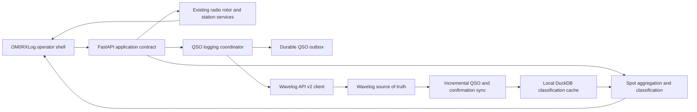

# OM0RXLog Product Merge and Delivery Plan

Date: 2026-10-08  
Status: Draft for approval  
Initial delivery focus: Wavelog API v2 and spots

OM0RXLog should be built as the next version of the existing OM0RX Radio Control application, using OpsLog as a product and interface reference rather than as the codebase to fork. This preserves the station-specific radio, amplifier, tuner, rotor, digital-mode, and safety work that already exists while adopting the cleaner logging workflow and visual organization that make OpsLog attractive.

The first product milestone is deliberately narrow: replace the current Wavelog v1 and direct-database dependencies with a reliable Wavelog API v2 integration, then rebuild the spots workspace around accurate Callsign Status, DXCC Status, and Special activity fields. Radio and rotor control remain in place. Broader logger features can be evaluated after this foundation is stable.

## Baseline and source constraints

Two baselines were reviewed:

- OM0RX Radio Control at `C:\Projects\om0rx-radio-control`, based on commit `9d20466854828193d9f4606905e822cfa97ff2f8`, plus substantial current uncommitted work.
- OpsLog cloned to `C:\Projects\OpsLog-reference` at commit `4d43a77d511ca40ce4a574b1a8bbd522ae69a887` from 2026-08-26.

The public OpsLog repository contains only `README.md` and `README.fr.md`. It does not contain the described Go, React, TypeScript, Wails, database, UI asset, or test sources, and it has no license file. OpsLog capabilities in this plan are therefore based on its published description and have not been verified against implementation. No OpsLog code, theme, icon, or other asset should be copied unless the maintainer supplies the source under a license or written permission that allows reuse.

The reference clone retains the upstream remote under the name `upstream`. The name OM0RXLog is reserved for our product and eventual repository or application rename.

## Product direction

The recommended direction is a clean evolution rather than a literal merge:

1. Keep the current Python station-control domain and hardware integrations.
2. Introduce a typed internal contract between the frontend and the station services.
3. Replace the Wavelog v1 client and normal-runtime database reads with Wavelog API v2.
4. Make the Wavelog-synced local index the fast classification cache, with Wavelog remaining the source of truth.
5. Redesign the operator shell and spots workspace using OpsLog's density, pane organization, and single-strip logging workflow as inspiration.
6. Add broader logging, awards, contest, and QSL functions only after the first milestone is accepted.

Changing the backend to Go or rebuilding all radio control inside Wails would add risk without improving the first milestone. A native desktop shell can be reconsidered later, after the domain contracts are stable.

## Capability comparison

| Area | OpsLog published capability | OM0RX current capability | OM0RXLog decision |
| --- | --- | --- | --- |
| Application shell | Wails desktop application with React and TypeScript, themes, configurable panes, and a compact logger | FastAPI, static Vue and JavaScript frontend, Python desktop launcher, and Windows tray supervisor | Keep the current runtime for the first milestone; redesign the shell and component boundaries without rewriting station services |
| Primary logbook | Local SQLite or shared MySQL, full CRUD, filtering, duplicate tools, ADIF import and export | Wavelog-first logging, local ADIF backup, durable retry outbox, recent-log views, DuckDB and PostgreSQL read caches, and some direct Wavelog MySQL access | Make Wavelog API v2 the only normal-operation authority; retain a local read and classification cache |
| Wavelog | Cloudlog and Wavelog upload and confirmation download are claimed; API version is not stated | Wavelog v1 `/api/qso`, `/api/private_lookup`, `/api/get_contacts_adif`, statistics endpoints, plus direct database reads | Implement a dedicated v2 client and controlled migration; retain v1 only as a temporary compatibility mode |
| Spots | Multiple cluster servers, reconnect, filters, duplicate grouping, new/new-band/new-slot/worked coloring, POTA tags, alerts, and band map | Cluster and RBL ingestion, persistent spot history, source aggregation, scoring, local-heard correlation, map and radar views, click-to-tune, CS and DS classification logic, and special-activity enrichment | Preserve the current data sources and automation; simplify the visual model and make classifications authoritative and explainable |
| Callsign status | Published new, new-band, new-slot, and worked states | New Call, New Band, New Mode, New Band+Mode, Worked, Confirmed, and Unknown | Retain richer history but define exact semantics and render it in a compact CS column |
| DXCC status | Worked-before coloring and awards data are claimed | ATNO, worked or confirmed, band and mode needs, CTY resolution, and provenance-aware repair of uncertain rows | Retain and formalize it in a compact DS column backed by the Wavelog v2 cache |
| Special activity | POTA spot tagging and award tracking for POTA, SOTA, IOTA, and WWFF | POTA, SOTA, IOTA, WWFF, WWBOTA or bunkers, ARLHS or lighthouses, castle, contest, and IARU tags; structured references can be written to QSO fields | Show program plus reference and provenance, not only a generic tag; keep extensibility |
| Radio control | OmniRig, FlexRadio, Icom, Elecraft or Kenwood, Yaesu, and TCI | Deep FlexRadio control with station-specific behavior and Elecraft KPA500 or KAT500 coordination | Do not migrate or rewrite for the first milestone; expose the existing service through a stable UI contract |
| Rotor control | PstRotator, Rotator Genius, and native microHAM ARCO, with a compass and click-to-turn | Native ARCO control, short and long path calculation, band policy, delayed cancellation, spot/manual/WSJT auto-rotation, and safety checks | Keep the current implementation; only integrate its status and commands into the cleaner shell |
| Digital operation | WSJT-X, JTDX, and MSHV decode ingestion; CAT sharing | WSJT-X or WSJT-Z bridge, built-in FT8 work, customized MSHV engine, automatic targeting, durable QSO logging, and station interlocks | Preserve as a differentiating OM0RX capability; no migration in the first milestone |
| Station automation | Relay automation by band or frequency, external program autostart | Radio, amplifier, tuner, rotor, digital-engine coordination, commissioning, alarms, training, and runtime ownership | Preserve; ensure the new UI never bypasses existing safety and authority checks |
| Awards and QSL | Broad awards engine, QSL services, card designer, confirmation download | Spot hunting and activity references, Wavelog-backed confirmation state, QRZ lookup, and local classification caches | Leave broad awards and QSL management in Wavelog initially; evaluate native views later |
| Contest and net logging | Contest session, exchange, scoring, duplicate checks, and directed-net logging | Not a primary feature | Post-milestone backlog |
| Profiles and multi-operator | Per-profile settings and shared MySQL live status | Station-specific OM0RX configuration | Post-milestone requirement analysis; use Wavelog station locations and token ownership first |
| Secrets | Optional encrypted vault | Ignored local secret files and environment settings | Add Windows credential storage or another encrypted vault as a later security work package |

## Capabilities to use from OpsLog

The following product ideas are suitable for clean-room reimplementation:

- A quiet, dense main workspace with configurable panes rather than many unrelated pages.
- A single-strip QSO entry flow with the current radio state, callsign lookup, and worked-before context close together.
- A spots filter rail that can be hidden without losing filter state.
- Compact status badges and consistent row colors across the spots table, band map, and worked-before views.
- A details drawer for secondary data instead of placing every value in the main grid.
- Configurable light, dark, and high-contrast themes using our own design tokens.
- Profile-aware station and logbook selection derived from Wavelog station locations.
- A future band map and alert rule editor built on the existing OM0RX spot sources.

The implementation must use original OM0RXLog layouts, styles, assets, and code. The public OpsLog repository does not currently provide a reusable implementation baseline.

## Capabilities to preserve from OM0RX

The following are preservation requirements, not migration candidates:

- FlexRadio connection, control, meters, tune and transmit safeguards.
- Elecraft KPA500 and KAT500 station coordination, commissioning, and telemetry.
- ARCO rotor control, short and long path bearings, band gates, cancellation delay, and automatic rotation.
- WSJT-X or WSJT-Z and MSHV integration, including logging deduplication and durable retry behavior.
- Station ownership, safety interlocks, alarms, health reporting, and the Windows tray supervisor.
- Cluster and RBL ingestion, local-heard correlation, persistent spot history, and click-to-tune behavior.
- CTY-based country and DXCC resolution.
- Structured POTA, SOTA, IOTA, WWFF, WWBOTA, and ARLHS reference extraction and QSO field mapping.
- Local worked and confirmed status cache for fast spot rendering.

## Target architecture

The frontend should never call Wavelog directly. Tokens remain in the backend secret store. Wavelog responses are normalized into stable OM0RXLog models so future Wavelog changes or an optional compatibility adapter do not leak into UI code.

## First milestone scope

The first milestone includes only work required to establish the new product foundation and deliver the two requested improvements.

### Included

- OM0RXLog product naming in the new UI and new documentation.
- Wavelog API v2 connection, token, scope, version, and station-location validation.
- QSO create, recent log read, incremental history sync, confirmation sync, callsign lookup, and basic statistics through v2.
- Durable and idempotent logging across network failures and restarts.
- Removal of normal-runtime dependence on the Wavelog MySQL schema.
- A canonical spot schema with Callsign Status, DXCC Status, Special references, source, confidence, and explanation.
- A redesigned spots table, filter rail, details drawer, and preserved tune and rotor actions.
- Automated tests plus a controlled station acceptance run.

### Excluded

- Rewriting FlexRadio, Elecraft, rotor, FT8, WSJT, or MSHV control.
- Porting the backend to Go or adopting Wails as a prerequisite.
- Copying OpsLog source or visual assets.
- Full native awards management, QSL card design, contest logging, directed-net logging, or multi-operator live pages.
- Deleting the legacy Wavelog path before rollback and parity tests pass.

## Wavelog API v2 work package

Wavelog API v2 requires Wavelog 3.1.0 or later and a dedicated `wl2_` token. It uses Bearer authentication, granular scopes, resource URLs, standard HTTP verbs, consistent response envelopes, and explicit pagination.

### Required scopes

The recommended minimum production token contains:

- `qso:read` and `qso:write` for history and logging.
- `lookup:read` for CS and DS verification.
- `station:read` for station-location selection and validation.
- `statistic:read` for summary tiles.
- `confirmation:read` for incremental LoTW, paper QSL, eQSL, QRZ, and Clublog receipts.

Delete and edit scopes are not required for the first milestone. Add `qso:delete` only when the UI intentionally gains delete functionality.

### Client responsibilities

Create one backend client with these responsibilities:

- Normalize base URLs with and without `index.php` without producing duplicated path segments.
- Add the Bearer token only to HTTPS requests outside explicitly allowed local development.
- Validate `/api/v2/status`, token metadata, station ownership, and required scopes during setup.
- Map v2 success and error envelopes into typed internal results.
- Respect `429` retry guidance and use bounded exponential backoff with jitter.
- Distinguish authentication, authorization, validation, conflict, rate-limit, transport, and unknown-outcome failures.
- Redact tokens and secret-bearing headers from logs and diagnostics.
- Record request correlation IDs and safe diagnostics without recording private QSO payloads by default.

### QSO write flow

Normal QSO creation should use `POST /api/v2/qso` with JSON fields and capture the returned Wavelog QSO ID. ADIF import remains available for bulk migration or compatibility cases.

The write coordinator must keep the existing durable outbox and deduplication protections. If a request times out after it may have reached Wavelog, the retry worker must reconcile the QSO identity before sending again. It must not blindly dual-write to v1 and v2.

### History and confirmation sync

The initial QSO sync uses `GET /api/v2/qso` or its ADIF representation with station filtering and pagination. Incremental QSO sync uses `since_id` and stores the highest successfully committed Wavelog ID only after the local transaction succeeds.

New QSO IDs do not reveal later confirmation changes. Confirmation state therefore requires a separate `GET /api/v2/confirmation?since=YYYY-MM-DD` poll with an overlap window, pagination, and idempotent upsert by QSO ID and confirmation type. A periodic reconciliation pass should protect against late or corrected data.

Direct Wavelog MySQL access can remain as a diagnostic or migration tool but should not be required to run OM0RXLog.

### Compatibility policy

- Prefer v2 whenever the server reports Wavelog 3.1.0 or later and a valid `wl2_` token is configured.
- Allow an explicit v1 compatibility mode for an older server during one migration period.
- Do not silently fall back from v2 to v1 after authentication, scope, or validation errors.
- Never enable simultaneous v1 and v2 QSO writes.
- Remove v1 normal-operation code only after the v2 soak period and rollback review.

## Spots classification work package

The current application already has separate callsign and DXCC classifications, but the names and provenance are spread across API lookup results, a local DuckDB cache, CTY data, live spot rows, and frontend formatting. OM0RXLog should make this one explicit domain model.

### Canonical spot fields

Every displayed spot should have:

| Field | Meaning |
| --- | --- |
| `callsign_status` | Worked or confirmed state of the exact callsign, including the requested band and mode slot |
| `dxcc_status` | Worked or confirmed state of the resolved DXCC entity, including the requested band and mode slot |
| `special_references` | Structured program and reference pairs such as `POTA OM-0123` or `SOTA OM/BA-001` |
| `worked_before_date` | Most recent QSO date for the exact callsign, band, and mode slot when available |
| `classification_source` | Local v2 cache, live v2 lookup, or unavailable |
| `classification_age` | Age of the underlying Wavelog sync or lookup |
| `dxcc_source` | CTY match, explicit source data, or unresolved |
| `spot_sources` | Cluster, RBL, local decode, or a merged set |
| `confidence` | Verified, derived, approximate, or unknown |
| `explanation` | Machine-readable reasons used by the details drawer and diagnostics |

### Callsign Status semantics

The visible `CS` column uses these display states:

- `New Call`
- `New Band`
- `New Mode`
- `New Band and Mode`
- `Worked`
- `Confirmed`
- `Unknown`

The stored model must keep overall, band, mode, and band-plus-mode booleans separately. This avoids making one label the source of truth. Before implementation, `New Mode` must be finalized as either a globally new mode or a new band-and-mode slot. OpsLog describes a new slot, while the current OM0RX implementation sometimes labels an unworked slot on a worked band as `New Mode`.

### DXCC Status semantics

The visible `DS` column uses these display states:

- `ATNO`
- `New Band`
- `New Mode`
- `New Band and Mode`
- `Worked`
- `Confirmed`
- `Unknown`

The UI may indicate whether the entity is confirmed overall but still needed on the current band or slot. Color is supportive only; every state also has text, a tooltip, and an accessible label.

### Special column semantics

The `Special` column should render badges containing the program and reference, not only the program name. It must support multiple references on one spot and preserve provenance.

Initial supported programs are:

- POTA
- SOTA
- IOTA
- WWFF
- WWBOTA or Bunkers on the Air
- ARLHS or lighthouse activity

Castle, contest, IARU, and future programs can remain generic tags until a validated reference grammar and QSO field mapping exist.

Reference extraction should prefer structured feed data or a program API, then validated comment patterns. A generic word such as `beacon`, `lighthouse`, or `WFF` without a valid reference must not create a structured activation reference.

### Classification authority

Use the following priority order:

1. Wavelog v2 synchronized local QSO and confirmation index for bulk classification.
2. Wavelog v2 full callsign lookup for an operator-selected row or an uncertain high-priority spot.
3. CTY data for callsign-to-DXCC resolution.
4. Structured activity feeds or validated references for the Special column.
5. `Unknown` when authoritative state is unavailable.

The UI must not display `ATNO` merely because the local cache is unavailable or still warming. Unknown data remains `Unknown` until verified.

### Spots workspace design

The first redesign should contain:

- A dense, resizable table with Time, Score, Band, Frequency, Callsign, Mode, Country, Spotter or Sources, CS, DS, Special, Worked before, and Comment.
- A compact filter rail for band, mode, source, CS, DS, special program, age, and worked-before state.
- A details drawer with classification evidence, source observations, CTY resolution, activity references, previous QSOs, and tune or rotate actions.
- A consistent row and badge palette shared by the table, radar or map, and later band map.
- Preserved click-to-tune, radio mode selection, TX halt or interlock, and optional delayed rotor AUTO.
- Saved column widths, visibility, sort, and filters per operator profile.
- Keyboard navigation and a high-contrast mode.

## Delivery plan

Estimates assume one experienced developer who knows the repository and timely access to a Wavelog 3.1 or later test instance. They are planning ranges, not commitments.

### Phase 0 Baseline and design decisions

Estimate: 2 to 4 days

- Preserve the current working tree in a reviewed commit or recoverable snapshot.
- Confirm the Wavelog server version and create separate development tokens.
- Capture the preferred OpsLog UI views as screenshots supplied by the user or maintainer.
- Approve CS and DS vocabulary and slot semantics.
- Approve whether one or multiple Wavelog station locations are in scope.
- Freeze the first-milestone API and UI acceptance criteria.

Exit criterion: implementation can begin without source, licensing, status-vocabulary, or Wavelog-version ambiguity.

### Phase 1 Wavelog API v2 foundation

Estimate: 1 to 2 weeks

- Add the v2 configuration and secret model.
- Implement connection, status, token, scope, and station validation.
- Implement QSO create and the durable unknown-outcome reconciliation flow.
- Implement QSO list and incremental history synchronization.
- Implement confirmation synchronization with overlap and idempotent upsert.
- Implement lookup, statistics, diagnostics, and health reporting.
- Add fixture-based contract tests for all success and failure envelopes.

Exit criterion: a test instance can log, read, sync, restart, recover, and classify without direct database access or duplicate QSOs.

### Phase 2 Canonical spots domain

Estimate: 1 to 2 weeks

- Define typed spot, status, reference, provenance, and explanation models.
- Replace label-based business logic with explicit booleans and derived display states.
- Connect the classifier to the v2-backed local index.
- Normalize special references and preserve multiple programs.
- Merge duplicate source observations under a stable spot identity.
- Add deterministic unit tests for CS, DS, special extraction, stale cache, and unknown states.

Exit criterion: the backend returns correct, explainable, source-aware spot objects independent of UI formatting.

### Phase 3 Spots user interface

Estimate: 1 to 2 weeks

- Build the clean table, compact filter rail, badges, and details drawer.
- Preserve tune, mode, TX halt, and rotor AUTO behavior through existing backend commands.
- Add saved layout and filter preferences.
- Test large spot sets, reconnects, rapid updates, and keyboard use.
- Perform visual review at standard laptop and station-monitor sizes.

Exit criterion: an operator can find, understand, tune, and rotate to a needed spot faster than in the current interface without losing safety behavior.

### Phase 4 Cutover and station validation

Estimate: 3 to 5 days plus soak time

- Run v1 and v2 read comparisons without dual-writing QSOs.
- Perform controlled manual, WSJT, and MSHV logging tests.
- Test Wavelog outage, token expiry, rate limiting, restart, and unknown write outcome.
- Run receive-only spot and rotor tests before any transmit-enabled test.
- Soak the v2 sync and spots UI for at least one normal operating cycle.
- Document rollback and operator recovery procedures.

Exit criterion: Wavelog v2 is the production path, spot status is trusted, and rollback has been demonstrated.

### Milestone estimate

Expected engineering effort is approximately 4 to 7 weeks, plus operator soak time. A framework rewrite or a full OpsLog feature clone is not included.

## Prioritized backlog

| ID | Priority | Deliverable | Acceptance summary |
| --- | --- | --- | --- |
| BASE-001 | P0 | Recoverable current baseline | Existing uncommitted work is preserved and implementation starts from a known revision |
| WL2-001 | P0 | v2 connection and capability probe | Version, token, scopes, and stations produce actionable diagnostics |
| WL2-002 | P0 | Secure token handling | Token is never returned to the frontend or written to logs |
| WL2-003 | P0 | QSO create | Manual and digital QSOs return a canonical Wavelog ID |
| WL2-004 | P0 | Durable retry and reconciliation | Timeout and restart tests do not create duplicates or lose accepted QSOs |
| WL2-005 | P0 | Initial and incremental QSO sync | `since_id` resumes from the last committed checkpoint |
| WL2-006 | P0 | Confirmation sync | Late confirmations update the local index without a full QSO reload |
| WL2-007 | P1 | Callsign lookup adapter | Full lookup supports CS and DS verification with band and mode |
| WL2-008 | P1 | Statistics and recent log | UI summary and recent contacts no longer use v1 endpoints |
| SPOT-001 | P0 | Canonical spot model | All sources produce the same validated backend schema |
| SPOT-002 | P0 | CS classifier | Exact callsign state is correct for overall, band, mode, and slot dimensions |
| SPOT-003 | P0 | DS classifier | DXCC worked and confirmed state never invents ATNO from missing data |
| SPOT-004 | P0 | Structured Special references | Valid program and reference badges survive source merging and QSO logging |
| SPOT-005 | P1 | Classification explanation | Every CS and DS label can be explained in the details drawer |
| UI-001 | P1 | Clean spots table | Dense layout, resizing, sorting, persistence, and accessible statuses work |
| UI-002 | P1 | Filter rail | Filters compose predictably and remain responsive on the live data set |
| UI-003 | P1 | Details drawer | Evidence, references, previous QSOs, tune, and rotate actions are available |
| SAFE-001 | P0 | Tune and rotor regression suite | UI redesign cannot bypass TX halt, station route, band, or rotor policies |
| CUT-001 | P0 | Migration and rollback runbook | v2 cutover and return to v1 compatibility are both documented and tested |

## Test and acceptance strategy

### Automated tests

- Wavelog v2 client tests from recorded and synthetic JSON envelopes.
- URL, authentication, redaction, scope, pagination, rate-limit, and error-mapping tests.
- QSO outbox tests for success, conflict, timeout before send, timeout after acceptance, restart, and repeated retry.
- QSO and confirmation synchronization tests for empty pages, multiple pages, overlap, duplicate rows, late confirmation, and partial transaction failure.
- Table-driven CS and DS tests across worked, confirmed, band, mode, slot, stale, warming, and unavailable states.
- Activity-reference tests for valid, ambiguous, overlapping, multiple, and malformed references.
- Frontend contract tests for filters, column persistence, details, tune, and rotor actions.
- Existing station-control, digital-engine, Elecraft, and rotor safety tests remain mandatory.

### Manual station acceptance

- Log one manual SSB or CW QSO and one digital QSO through the v2 path.
- Verify both appear once in Wavelog and once in the local index.
- Verify CS and DS change immediately after logging.
- Import a later LoTW or paper confirmation and verify the relevant status changes after the confirmation poll.
- Tune a spot while receiving and verify frequency and mode.
- Attempt a tune while transmitting and verify the existing halt or interlock behavior.
- Test rotor AUTO on an allowed band, a blocked band, an approximate location, and a cancelled delayed action.
- Disconnect Wavelog and verify spots remain usable with clearly stale or unknown status rather than false ATNO labels.

## Cutover and rollback

The rollout should use feature flags for `wavelog_protocol`, `spots_schema_version`, and `spots_ui_version`.

1. Deploy v2 reads and compare them with the existing cache while v1 remains the write path.
2. Stop background tasks briefly, take local cache and settings backups, and record the last v1 sync marker.
3. Enable v2 QSO writes for one operator path at a time.
4. Enable v2 history and confirmation sync.
5. Enable the new spots schema and UI after backend classification parity passes.
6. Keep v1 compatibility available but inactive through the soak period.
7. Remove direct database requirements only after production acceptance.

Rollback disables the new UI and v2 workers, restores the saved configuration, re-enables the single v1 write path, and rebuilds the local status cache from Wavelog. Pending outbox items must be reconciled before any protocol switch so the same contact is not submitted through both APIs.

## Risks and mitigations

| Risk | Impact | Mitigation |
| --- | --- | --- |
| OpsLog source and license are unavailable | A literal code merge is impossible and copying assets would be unsafe | Use clean-room product inspiration; request source and license separately if desired |
| Current OM0RX worktree has extensive uncommitted changes | New work could overwrite or entangle active station development | Create a reviewed baseline snapshot before implementation and keep the milestone on a dedicated branch |
| Wavelog server is below 3.1.0 | API v2 cannot be used | Upgrade first or keep explicit v1 compatibility until the server is ready |
| v2 token lacks a required scope or expires | Logging or classification can stop | Validate on startup, expose actionable health, and alert before known expiry |
| Unknown network outcome creates duplicate QSO retries | Log corruption or operator uncertainty | Reconcile identity before retry and keep one active write protocol |
| `since_id` does not capture later confirmations | CS and DS can become stale | Poll the confirmation resource with an overlap window and periodic reconciliation |
| Spot sources disagree or contain ambiguous comments | Incorrect Special tags or status | Preserve provenance, prefer structured data, validate reference grammars, and show Unknown when necessary |
| UI redesign bypasses station safeguards | Hardware or RF safety risk | Keep all actions behind current backend commands and run safety regression tests |
| Framework rewrite expands scope | First milestone is delayed | Keep FastAPI and current runtime until contracts and workflows are accepted |

## Decisions required before implementation

The following decisions belong in Phase 0:

1. Confirm that the target Wavelog instance will run version 3.1.0 or later.
2. Confirm whether OM0RXLog should use one station location or allow selection among multiple locations in the first milestone.
3. Approve the recommended Wavelog-as-source-of-truth model and removal of normal direct MySQL reads.
4. Define `New Mode` versus `New Slot` for both CS and DS. The recommendation is to display `New Slot` when only the exact band-and-mode combination is new.
5. Provide screenshots of the specific OpsLog screens and interactions to emulate, because the public repository contains no UI source or screenshots.
6. Decide whether a native Wails-style wrapper is a later packaging goal or whether the existing tray and local-window approach is sufficient.
7. Decide whether to contact the OpsLog maintainer for source access and an explicit license. This is optional for the recommended clean-room approach.

## Recommended first sprint

The first sprint should complete BASE-001 and WL2-001 through WL2-005. Its tangible output is a tested Wavelog v2 client that can validate the installation, list station locations, write one QSO safely, and rebuild or increment the local QSO index without direct database access.

The spots UI should not be restyled before this client and canonical status model are available. Otherwise the new interface would preserve the current classification ambiguities under cleaner visuals.

## References

- [OpsLog public repository](https://github.com/GregTroar/OpsLog)
- [Wavelog API v2 overview](https://docs.wavelog.org/developer/api-v2/)
- [Wavelog API v2 QSO resource](https://docs.wavelog.org/developer/api-v2/qso/)
- [Wavelog API v2 Lookup resource](https://docs.wavelog.org/developer/api-v2/lookup/)
- [Wavelog API v2 Confirmation resource](https://docs.wavelog.org/developer/api-v2/confirmation/)
- [Wavelog API v2 Station resource](https://docs.wavelog.org/developer/api-v2/station/)
