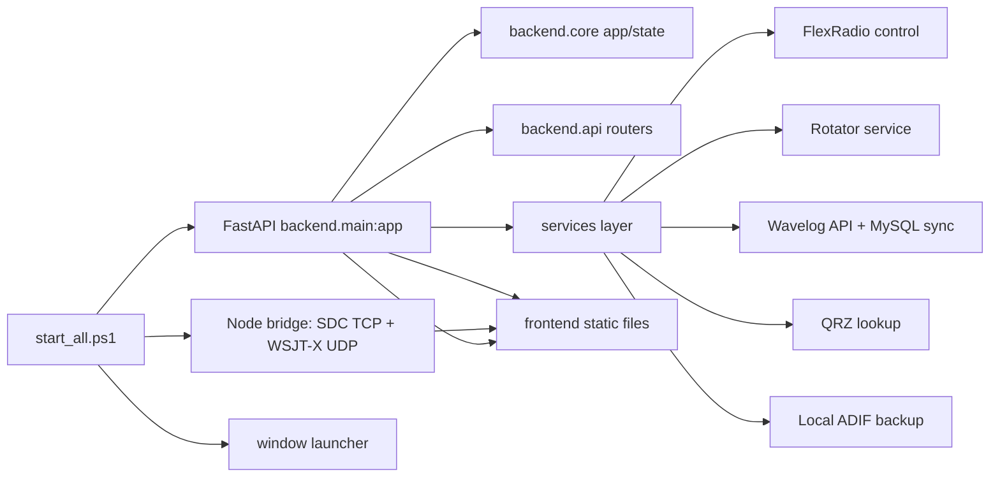

# OM0RX Radio Control Project Review

Date: 2026-05-26
Branch reviewed: `codex/project-cleanup`

This document is the baseline technical review for the project after the cleanup and architecture
polish passes. It describes how the project is currently structured, how it starts, where important
runtime state lives, what was fixed during review, and what should be improved before adding new
features.

## Current Project Shape

OM0RX Radio Control is a local station-control application for a FlexRadio-based station. It combines:

- A FastAPI backend in `backend/`.
- A service layer in `services/`.
- Core radio, cluster, logging, Wavelog, QRZ, CTY, and ADIF logic in `radio_control/`.
- A browser-based frontend in `frontend/`.
- A Node.js bridge in `bridge/` for SDC Skimmer TCP traffic and WSJT-X UDP traffic.
- Runtime data in `data/`, logs in `logs/`, tracked non-secret settings in `settings/`, and local secrets in ignored `config_local.py` or `settings/local_secrets.json`.

The primary user entry point is:

```powershell
.\start_all.ps1
```

That script starts:

1. `bridge/sdc-bridge-server.js`
2. `uvicorn backend.main:app`
3. `scripts/launch/launch_windows.py`

## Runtime Architecture



Important ownership boundaries:

- `backend/main.py` orchestrates startup, dependency creation, route registration, and shutdown.
- `backend/core/__init__.py` owns the FastAPI app object, shared runtime state declarations, validation handling, and rotor settings bootstrap only.
- `services/` contains backend service behavior, but some services still use module-level globals.
- `radio_control/config.py` centralizes defaults and project-relative paths, then layers `config_local.py`, JSON runtime settings, ignored local secrets, and environment overrides.
- `settings/app_settings.json` persists non-secret runtime settings, including rotor AUTO and FT8 settings.

## What Was Fixed During This Review

These were review findings that were low-risk enough to fix immediately:

- Fixed lazy imports that still referenced pre-package root modules such as `utils`, `spots_logger`, `wavelog_api`, and `config`.
- Fixed WSJT-X auto-rotate dependency wiring so it receives the high-level `RotatorService`, not the raw `RotorController`.
- Fixed WSJT-X auto-rotate band conversion from Hz to kHz and made rotor band config support the current boolean settings format.
- Added missing `/api/rotor/auto/bearing` alias used by the frontend.
- Removed duplicate `/api/ft8/config` handlers and moved FT8 config persistence into the shared settings model.
- Fixed `WavelogDuckDBSync` and legacy `ADIFSyncManager` default DuckDB paths to use `config.DATA_DIR`.
- Fixed WSJT-X parser frequency values to return JavaScript numbers instead of BigInt values.
- Fixed `tests/smoke/test_ft8_files.py` to look at the real root `frontend/` directory.
- Aligned Python package metadata version with the app/package version: `2.0.0`.
- Removed deprecated route handlers, startup handlers, duplicate Pydantic models, and copied background workers from `backend/core/__init__.py`.
- Moved Wavelog periodic background task startup to import directly from `radio_control/wavelog_duckdb_sync.py`.
- Removed the remaining duplicate `GET /api/sync-status` registration and made the route report from the active Wavelog sync manager.
- Replaced `/api/config` source-code writes with JSON-backed runtime settings in `settings/app_settings.json` and ignored `settings/local_secrets.json`.
- Updated legacy config helpers to use the same JSON settings store instead of editing `radio_control/config.py`.
- Hardened launch scripts to bind the backend to `127.0.0.1` by default and make Uvicorn reload a development-mode opt-in.
- Updated window launchers to respect `BACKEND_HOST` and `BACKEND_PORT` instead of hard-coded `localhost:8000`.
- Restricted default CORS origins to local UI origins and added `CORS_ALLOWED_ORIGINS` for explicit overrides.
- Consolidated rotor AUTO and FT8 config persistence into `settings/app_settings.json`, with legacy JSON read fallback only.
- Added a lifecycle-aware startup supervisor: backend restart/shutdown endpoints now write an ignored runtime request file and exit, while `start_all.ps1` or `scripts/start/start_services_only.ps1` owns restarting sibling bridge/backend processes.
- Added `scripts/maintenance/check_project.ps1` as the fast local quality gate and exposed it through `npm run check`.
- Introduced `backend.core.context.AppContext` as the explicit runtime context and wired backend startup, health/status, Wavelog sync status, server-control cleanup, and WebSocket ownership through it.
- Removed remaining active-tree legacy product strings from maintained code and tightened the quality-gate stale-reference scan.

## Review Findings

### P2: Runtime State Is Still Partly Spread Across Globals And Setters

State exists in:

- `backend.core.context.AppContext`.
- legacy `backend.core` compatibility globals.
- legacy `app.state.*` attributes synchronized from the context.
- `services.radio` globals.
- `services.background_tasks` globals.
- module-level singleton services such as FT8, ADIF, Wavelog, WSJT-X, and rotor.

Examples:

- `backend/main.py:68`
- `backend/main.py:299`
- `services/background_tasks.py:49`
- `services/radio.py:469`

Risk:

- Dependency ownership is clearer at the app boundary, but several services still receive state through global setters.
- Some tests still import and mutate process-global state.
- Registering routes more than once can duplicate handlers.
- Shutdown and reconnect behavior is hard to verify.

Recommended fix:

- Continue moving service dependencies onto `AppContext`.
- Replace service-level global setters with constructor or FastAPI dependency injection where practical.
- Keep legacy `app.state.*` compatibility only while routers migrate.

### P2: WebSocket Broadcast Lists Are Not Protected

`services/websocket.py` keeps clients in a mutable list and removes disconnected clients while other broadcasts may be iterating:

- `services/websocket.py:14`
- `services/websocket.py:25`
- `services/websocket.py:32`
- `services/websocket.py:44`
- `services/websocket.py:51`

Risk:

- Concurrent broadcasts can mutate the same list.
- A stale client may survive or a client may be removed twice.

Recommended fix:

- Use a `ConnectionManager` class with an `asyncio.Lock`.
- Store clients in a `set`.
- Send from a snapshot and handle disconnect cleanup centrally.

### P2: Tests Need Better Separation After The Quality Gate

Current state:

- `scripts/maintenance/check_project.ps1` runs the fast local quality gate.
- The default gate excludes checks that need MySQL, audio devices, live WSJT-X packets, or network access.
- `pyproject.toml` declares a `dev` optional dependency group for `pytest` and `ruff`.
- Several smoke scripts are still executable diagnostics rather than pure tests.

Risk:

- A full `pytest tests/smoke` run is still not the right command because some scripts perform live integration work at import/runtime.
- Live station checks are useful, but they need explicit naming and isolation.

Recommended fix:

- Move pure tests into a dedicated test subset that can run under pytest by default.
- Keep hardware/live-radio checks under an explicit integration path or naming convention.
- Add CI later once pure tests are isolated from station-specific checks.

### P2: Frontend Is Functional But Too Large And Untyped

The frontend is mostly static JS with a very large `app-main.js`, direct DOM access, and many direct `fetch()` calls.

Risk:

- API contract changes are easy to miss.
- UI state and transport code are tightly coupled.
- There is no lint/type check/build gate.

Recommended fix:

- Keep the current no-build app for now, but split frontend code by domain:
  - API client module
  - WebSocket client module
  - radio controls
  - rotor controls
  - logging
  - FT8
  - modals
- Add lightweight contract tests for fetch endpoints used by the frontend.

### P2: Wavelog Sync Is Operational But Needs Hardening

`radio_control/wavelog_duckdb_sync.py` now writes to the correct project data directory. The sync logic is clear, but still has risk areas:

- Initial sync uses `LIMIT/OFFSET`, which can become slow on large tables.
- Sync metadata assumes `last_modified` is reliable and monotonic.
- Database connections are opened per batch and should be reviewed for timeout and error behavior.

References:

- `radio_control/wavelog_duckdb_sync.py:198`
- `radio_control/wavelog_duckdb_sync.py:316`
- `radio_control/wavelog_duckdb_sync.py:505`

Recommended fix:

- Prefer keyset pagination for initial sync.
- Add tests for incremental sync edge cases.
- Add explicit status for failed sync versus no changes.

### P3: Dependency And Metadata Management Is Duplicated

Dependencies are listed in both `requirements.txt` and `pyproject.toml`.

Risk:

- Versions can drift.
- Developers may install a different set depending on which file they use.

Recommended fix:

- Choose `pyproject.toml` as the source of truth.
- Keep `requirements.txt` generated or clearly documented as a compatibility install path.
- Add dev dependencies separately.

## Verification Performed

Passed:

- Python syntax check across maintained Python files.
- PowerShell parser check across tracked `.ps1` files.
- Bash syntax check for `scripts/start/start_webapp.sh`.
- Node syntax check for bridge and WSJT-X smoke scripts.
- `npm audit --omit=dev`.
- `python -c "import backend.main"`.
- FastAPI route-table duplicate scan.
- `python -m pip install -e . --dry-run`.
- `python scripts\maintenance\check_sync_status.py`.
- `python tests\smoke\test_ft8_files.py`.
- `python tests\smoke\test_qth_data.py`.
- `python tests\smoke\test_config_save.py`.
- `python tests\smoke\test_app_context.py`.
- `python tests\smoke\test_lifecycle_contract.py`.
- `powershell -NoProfile -ExecutionPolicy Bypass -File scripts\maintenance\check_project.ps1`.
- `node tests\smoke\test-wsjtx-udp.js` received live WSJT-X packets.

Not run by default because they need local station resources:

- MySQL-backed Wavelog diagnostics.
- Audio-device FT8 diagnostics.
- Live WSJT-X packet checks.

## Recommended Next Work

Do these before adding new features:

1. Add endpoint contract tests for all frontend fetch/WebSocket paths.
2. Continue migrating routers/services from legacy globals to `AppContext`.
3. Separate pure tests from live station diagnostics so pytest can become the default unit test runner.
4. Split the largest frontend modules after backend contracts are stable.
5. Harden Wavelog sync pagination and failure status reporting.

## Development Standards Going Forward

- Do not add new runtime files at the project root unless they are true root-level project metadata.
- Keep station-specific secrets out of Git.
- New backend endpoints should live in `backend/api/` and call service-layer code.
- Shared station/domain logic should live in `radio_control/`.
- Service objects should receive dependencies explicitly where possible.
- Every bug fix should include either a smoke check, a unit test, or a documented manual verification.
- Hardware/live-radio checks should be marked separately from pure tests.
- Avoid adding another global singleton unless there is no practical alternative.
